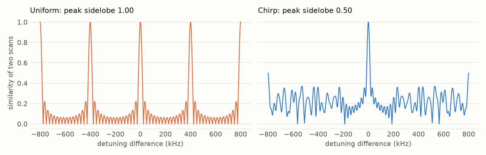

# Dawn Chorus

**Tune a superconducting qubit in 16 circuits by listening to its noise through a chirp.**

A quantum computer regularly needs to know two things about each qubit: how far its frequency has drifted, and how long it stays coherent. A Ramsey scan measures both. Its usual evenly spaced delays alias, though: different frequency errors can produce identical data, so covering a wide range takes more circuits or a shorter, less precise scan.

Dawn Chorus replaces the even spacing with a chirp. Delays grow quadratically, so the sampling rate sweeps from fast to slow. One fixed list of 16 delays then removes aliasing across the whole search range and reads the frequency error and the decay envelope from the same data.

| 16 circuits, 256 shots each, 300 trials | Failures (error > 10 kHz) | Detuning RMSE | T2 fit / true T2 (middle 50%) |
|---|---|---:|---|
| Uniform, longest delay 40 µs | **82%** | 1.36 kHz (surviving trials only) | 0.82 to 1.26 (surviving trials only) |
| Uniform, short enough not to alias | 0% | 0.66 kHz | 0.71 to 2.09 |
| Two-stage (short uniform + long uniform) | 0% | 0.60 kHz | 0.86 to 1.24 |
| Geometric | 0% | 0.45 kHz | 0.86 to 1.28 |
| Random, redrawn every scan | 0% | **0.29 kHz** | 0.86 to 1.23 |
| **Chirp (this project)** | **0%** | 0.34 kHz | **0.84 to 1.16** |

Against alias-free uniform spacing, the chirp halves the error at the same cost. Because RMSE scales as 1/√shots, that baseline would need nearly 4 times the shots to match. Random schedules are about 13% more precise on average, and the reason to still prefer the chirp is explained below. If the drift is already known to be small, plain uniform spacing is the better choice (see [Limits](#limits)).

**Everything here is simulated.** No real quantum hardware was used. See [Limits](#limits).



## How this relates to Chi(r)ps & Qreativity

- **Chirp.** The delay schedule is a chirp in the radar sense, and the analysis uses the radar tool for it, the ambiguity function.
- **Noise as the material.** Nothing is mitigated or discarded. The decay of the fringes is the T2 measurement, and the fringe frequency is the drift. The noise is the signal being read.
- **Tuning and resonance.** The output is the correction that puts a qubit back on resonance.
- **Birds.** The benchmark runs over IBM's Falcon, Eagle and Heron processor families. The name comes from the dawn chorus, when birds sing at first light, which is when a morning tune-up runs.

## The quantum part

### Circuit

One qubit, one Ramsey sequence per delay τ:

```
|0⟩ ── H ── delay(τ) ── Rz(2π f₀ τ) ── H ── measure
```

`f₀ = 400 kHz` is a deliberate offset that fixes the sign of the frequency error. Rz is virtual, so it costs no gate time or error. On a real device the delay would carry the actual detuning δ. Snapshot noise models contain no frequency error, so δ is injected as an extra virtual Z, which is how a detuning appears in the rotating frame.

### Model

The excited-state fraction, with readout and gate errors absorbed by A and B, is

```
p(τ) = B + A · exp(-τ / T2) · cos(2π (f₀ + δ) τ)
```

The fit searches δ and T2 on a grid. For each pair, A and B have a closed-form least-squares solution, so SPAM needs no separate calibration. The best pair is then polished on a finer grid ([estimator.py](dawnchorus/estimator.py)).

### Why even spacing fails

With τₖ = k·Δτ, adding 1/Δτ to the frequency changes each phase by exactly 2πk, so the data do not change at all. With 16 circuits and a 40 µs longest delay, the fringes repeat every 400 kHz. Shifted and sign-mirrored copies land inside the search range. For a true detuning of 180 kHz, the detunings −220, −180, 180 and 220 kHz all fit the data equally well. The tie is exact, so the fit can only pick one arbitrarily, and it is wrong about three times in four. Which one it picks depends on floating-point rounding and can differ between machines.

Shrinking Δτ removes the alias, but the longest delay shrinks with it (9.4 µs here, for an 850 kHz bandwidth), and precision depends on the longest delays.

### Why a chirp works

Two scans at detunings differing by d look alike in proportion to the ambiguity function

```
χ(d) = | (1/M) Σₖ exp(2πi d τₖ) |
```

The width of its central peak sets the precision. Any other high peak is a potential alias. With τₖ = τ_max (k/M)²:

| Schedule, M = 16 | Half-width of peak | Highest other peak within ±800 kHz |
|---|---:|---:|
| Uniform | 15.3 kHz | 1.00 |
| Chirp | 14.5 kHz | 0.50 |
| Geometric | 38.0 kHz | 0.51 |

The chirp keeps the narrow peak of a long uniform scan and halves the worst sidelobe. Two-stage scheduling reaches a similar 14.8 kHz and 0.55 on this measure, yet its RMSE is worse because half of its circuits are short and carry little precision. All its delays are multiples of 156 ns, so it does have an exact alias at 6.4 MHz, far outside the search range.

### Chirp or random?

Random delays gave the lowest RMSE, and I report that plainly. The catch is variation between draws. Over 500 draws, the worst sidelobe was:

| M | Chirp (fixed) | Random, median | Random, 95th percentile | Random, worst |
|---|---:|---:|---:|---:|
| 8 | 0.72 | 0.73 | 0.87 | 0.99 |
| 16 | 0.50 | 0.53 | 0.67 | 0.77 |

A worst draw comes close to a full alias. A tune-up runs on every qubit repeatedly, so a schedule you can inspect once and then trust has real value. If average precision matters most and a rare bad draw is acceptable, use random. Below 12 circuits the chirp is not safe either: at M = 8 it failed in 2 of 300 trials, random in 4, and geometric in 0.

### Precision against the theoretical floor

[`crlb`](dawnchorus/estimator.py) computes the Cramér-Rao bound assuming T2, A and B are known. It is a floor, since the fit must estimate them too. At M = 16, the chirp reaches 0.34 kHz against a median floor of 0.20 kHz.

## Qiskit stack

[`scripts/run_benchmark.py`](scripts/run_benchmark.py) uses a fast one-qubit density-matrix model built from each qubit's reported T1, T2, sx error and readout error. It covers 172 qubits on 30 snapshot backends and lets a 30-configuration sweep finish in minutes.

[`scripts/validate_full_stack.py`](scripts/validate_full_stack.py) then checks the result against the standard path:

- `transpile(..., initial_layout=[q], optimization_level=1, scheduling_method="alap")` lowers each circuit to native gates and schedules it.
- `AerSimulator.from_backend` supplies the backend's noise model, including relaxation during delays.
- `qiskit_aer.primitives.SamplerV2` runs the circuits.

Over 120 chirp scans at M = 16 (5 qubits, 4 scans each, on Cairo, Hanoi, Sherbrooke, Kyiv, Torino and Marrakesh): **no failures, 0.45 kHz RMSE, and a median T2 ratio of 0.97** (middle 50%: 0.87 to 1.19). The RMSE is higher than the fast model's 0.34 kHz. The qubits differ and this path carries more complete noise, and I have not separated those two causes.

## Reproduce

Tested on Python 3.14.

```bash
python -m venv venv && source venv/bin/activate
pip install -r requirements.txt
pytest tests
python scripts/demo.py                  # one qubit, under a minute
python scripts/run_benchmark.py         # a few minutes, writes results/benchmark.csv
python scripts/validate_full_stack.py   # a few minutes, writes results/full_stack.csv
python scripts/make_figures.py
```

`demo.py` injects a detuning into a typical Sherbrooke qubit and compares schedules. With 180 kHz injected, four answers fit the uniform scan (−220, −180, 180 and 220 kHz). One fits the chirp, which refines to 180.15 kHz.

Seeds are fixed. The uniform row may differ slightly between machines because of the exact ties described above.

## Limits

- **No hardware.** All results come from simulators using snapshot calibration data. Real qubits have non-exponential decay, frequency jumps during a scan, and charge noise. None of these are in the model, and any of them could erode the advantage.
- **The advantage needs a wide search range.** Frequency errors are drawn uniformly from ±300 kHz. That range was my choice, not a measurement of how far real qubits drift. If the drift is known to be well under the 400 kHz alias spacing, plain long uniform spacing has no ties and a lower bound (0.16 kHz against the chirp's 0.20 kHz), so it should win.
- **No adaptive baseline.** A scheme that chooses each delay from the previous results is likely to beat every fixed schedule here. Fixed schedules are simpler to run in a batch, but I did not measure that trade-off.
- **T2 far above the longest delay is poorly determined.** A 40 µs scan cannot pin down a 500 µs T2.
- **Tuning choices.** The 10 kHz failure threshold and `f₀` were chosen by me for this comparison.
- **Single qubit.** The circuit uses no entanglement, and spectator and crosstalk effects are not studied.
- **Not new physics.** Non-uniform Ramsey sampling and log-spaced phase estimation are established. What this project adds is a simple fixed schedule and an open comparison over many device calibrations.

## Built in

Started on 2026-11-01, before the hackathon brief was published.

## License

MIT
